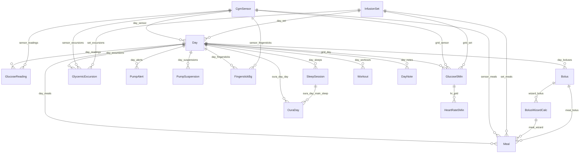

# Ontology catalog: `t1d` v1

_Generated by `t1d run` from `ontology/ontology.yaml`. Do not edit by hand._

| Object type | Kind | Primary key | Rows | Backing dataset |
|---|---|---|---|---|
| Day | object | `date_local` | 248 | `clean/day` |
| GlucoseReading | object | `reading_id` | 81,159 | `clean/glucose_reading` |
| CgmSensor | object | `sensor_id` | 20 | `clean/cgm_sensor` |
| InfusionSet | object | `set_id` | 98 | `clean/infusion_set` |
| Bolus | object | `bolus_id` | 1,024 | `clean/bolus` |
| BolusWizardCalc | object | `wizard_id` | 1,065 | `clean/bolus_wizard_calc` |
| Meal | object | `meal_id` | 935 | `clean/meal` |
| GlycemicExcursion | object | `excursion_id` | 579 | `clean/glycemic_excursion` |
| PumpAlert | object | `alert_id` | 2,118 | `clean/pump_alert` |
| PumpSuspension | object | `suspension_id` | 426 | `clean/pump_suspension` |
| FingerstickBg | object | `bg_id` | 309 | `clean/fingerstick_bg` |
| ClockChange | object | `clock_change_id` | 23 | `clean/clock_change` |
| OuraDay | object | `date_local` | 249 | `clean/oura_day` |
| SleepSession | object | `sleep_id` | 334 | `clean/sleep_session` |
| Workout | object | `workout_id` | 106 | `clean/workout` |
| Experiment | object | `experiment_id` | 0 | `writeback/experiment` |
| DayNote | object | `note_id` | 0 | `writeback/day_note` |
| Glucose5Min | dataset | `bin_start_utc` | 71,174 | `clean/glucose_5min` |
| HeartRate5Min | dataset | `bin_start_utc` | 42,038 | `clean/heart_rate_5min` |

## Day

One local calendar day. The hub every source hangs off: CGM metrics, insulin, carbs, excursions, device state. Future Oura / Apple Health day-level objects link here.

**Links:** `day_readings` → GlucoseReading (81,159 linked), `day_boluses` → Bolus (1,024 linked), `day_meals` → Meal (935 linked), `day_excursions` → GlycemicExcursion (579 linked), `day_alerts` → PumpAlert (2,118 linked), `day_suspensions` → PumpSuspension (426 linked), `day_fingersticks` → FingerstickBg (309 linked), `day_sensor` → CgmSensor (248 linked), `day_set` → InfusionSet (248 linked), `grid_day` → Glucose5Min (71,174 linked), `oura_day_day` → OuraDay (248 linked), `day_sleeps` → SleepSession (332 linked), `day_workouts` → Workout (106 linked), `day_notes` → DayNote (0 linked)

| Property | Type | Description |
|---|---|---|
| `date_local` (PK) | date |  |
| `weekday` | string |  |
| `grid_bins` | integer | 5-min bins in the local day (287/289 on clock-change days) |
| `bins_with_data` | integer |  |
| `cgm_coverage` | double | Share of bins with a CGM value |
| `is_valid_cgm_day` | boolean | Coverage >= 70% and not a partial export day |
| `is_partial_day` | boolean | First or last day of the export |
| `mean_sg_mgdl` | double |  |
| `sd_sg_mgdl` | double |  |
| `cv_pct` | double | Coefficient of variation (target <= 36%) |
| `gmi_pct` | double | Glucose management indicator (estimated A1c) |
| `tir` | double | Time in range 70-180 mg/dL (share) |
| `titr` | double | Time in tight range 70-140 mg/dL (share) |
| `tbr` | double | Time below 70 mg/dL (share) |
| `tbr_level2` | double | Time below 54 mg/dL (share) |
| `tar` | double | Time above 180 mg/dL (share) |
| `tar_level2` | double | Time above 250 mg/dL (share) |
| `mean_sg_overnight_mgdl` | double | Mean SG 00:00-06:00 local |
| `bolus_u` | double | Insulin from user boluses |
| `auto_insulin_u` | double | SmartGuard auto basal + auto corrections (pump daily aggregate) |
| `tdd_u` | double | Total daily dose = bolus_u + auto_insulin_u |
| `auto_insulin_share` | double | How hard the loop worked: auto_insulin_u / tdd_u |
| `n_boluses` | integer |  |
| `n_correction_boluses` | integer |  |
| `n_manual_mode_boluses` | integer | Boluses given with SmartGuard off |
| `n_meals` | integer |  |
| `carbs_g` | double |  |
| `n_hypo` | integer |  |
| `n_hypo_level2` | integer |  |
| `n_hypo_nocturnal` | integer |  |
| `hypo_minutes` | integer |  |
| `n_hyper` | integer | Episodes >250 mg/dL |
| `n_alerts` | integer |  |
| `n_low_alerts` | integer |  |
| `n_high_alerts` | integer |  |
| `n_smartguard_exits` | integer |  |
| `n_signal_loss_alerts` | integer |  |
| `suspended_minutes` | double |  |
| `n_suspensions` | integer |  |
| `sensor_id` | string | CGM sensor worn most of the day |
| `sensor_day` | integer | Day of sensor wear at local noon (1 = first day) |
| `set_id` | string | Infusion set worn most of the day |
| `set_day` | integer | Day of infusion-set wear at local noon |
| `utc_offset_min` | double |  |
| `is_travel_day` | boolean |  |
| `n_clock_changes` | integer |  |

## GlucoseReading

One CGM value as received by the pump (Abbott Instinct). ~10% are late re-receipts of the same sample; use Glucose5Min for analysis.

**Links:** `day_readings` → Day (81,159 linked), `sensor_readings` → CgmSensor (81,159 linked)

| Property | Type | Description |
|---|---|---|
| `reading_id` (PK) | string |  |
| `ts_utc` | timestamp |  |
| `ts_local` | timestamp |  |
| `date_local` | date |  |
| `utc_offset_min` | double |  |
| `sg_mgdl` | double |  |
| `at_upper_limit` | boolean | Sensor reports 400 = ">=400" |
| `at_lower_limit` | boolean | Sensor reports 40 = "<=40" |
| `ts_repaired` | boolean | Timestamp had a whole-day error that was repaired |
| `sensor_id` | string |  |
| `batch_id` | string |  |
| `source_file` | string |  |
| `source_line` | integer |  |

## CgmSensor

One physical Instinct sensor, from pairing until the next sensor is paired.

**Links:** `day_sensor` → Day (248 linked), `sensor_readings` → GlucoseReading (81,159 linked), `sensor_meals` → Meal (935 linked), `sensor_excursions` → GlycemicExcursion (579 linked), `sensor_fingersticks` → FingerstickBg (309 linked), `grid_sensor` → Glucose5Min (71,173 linked)

| Property | Type | Description |
|---|---|---|
| `sensor_id` (PK) | string | Sensor serial as reported over BLE |
| `sensor_number` | integer | 1 = first Instinct sensor |
| `first_paired_utc` | timestamp |  |
| `first_reading_utc` | timestamp |  |
| `last_reading_utc` | timestamp |  |
| `removed_utc` | timestamp |  |
| `window_end_utc` | timestamp | Next sensor's pairing (null for the current one) |
| `end_state` | string | removed | replaced | active_at_export |
| `warmup_minutes` | double |  |
| `wear_days` | double |  |
| `is_full_wear` | boolean | Wear >= 14 days |
| `n_pairings` | integer | BLE (re)pairings; many = connectivity trouble |
| `n_readings` | integer |  |
| `expected_bins` | integer |  |
| `bins_with_data` | integer |  |
| `coverage` | double |  |
| `n_sensor_errors` | integer |  |
| `n_failed_bg_checks` | integer |  |
| `n_signal_loss_alerts` | integer |  |

## InfusionSet

One reservoir + infusion-set change (rewind, tubing fill, cannula fill) and its wear period.

**Links:** `day_set` → Day (248 linked), `set_meals` → Meal (935 linked), `set_excursions` → GlycemicExcursion (579 linked), `grid_set` → Glucose5Min (71,174 linked)

| Property | Type | Description |
|---|---|---|
| `set_id` (PK) | string |  |
| `change_started_utc` | timestamp |  |
| `started_utc` | timestamp | Last prime of the change = insulin flowing again |
| `started_local` | timestamp |  |
| `ended_utc` | timestamp |  |
| `wear_hours` | double |  |
| `reservoir_fill_u` | double |  |
| `tubing_prime_u` | double |  |
| `cannula_prime_u` | double |  |
| `had_rewind` | boolean |  |
| `started_before_era` | boolean | Set was already in place when the Instinct era began |
| `batch_id` | string |  |
| `source_file` | string |  |
| `source_line` | integer |  |

## Bolus

One user-initiated bolus, assembled from its programmed / delivered / canceled fragments. SmartGuard's own auto-corrections are NOT here. The pump only exports them as a daily total (Day.auto_insulin_u).

**Links:** `day_boluses` → Day (1,024 linked), `wizard_bolus` → BolusWizardCalc (1,024 linked), `meal_bolus` → Meal (927 linked)

| Property | Type | Description |
|---|---|---|
| `bolus_id` (PK) | string |  |
| `bolus_number` | integer |  |
| `start_utc` | timestamp |  |
| `programmed_utc` | timestamp |  |
| `programmed_local` | timestamp |  |
| `delivered_utc` | timestamp |  |
| `delivery_minutes` | double |  |
| `date_local` | date |  |
| `units_programmed` | double |  |
| `units_delivered` | double |  |
| `is_partial` | boolean |  |
| `was_canceled` | boolean |  |
| `cancel_reason` | string |  |
| `bolus_type` | string |  |
| `bolus_source` | string |  |
| `bolus_kind` | string | meal_and_correction | correction | wizard_manual_mode |
| `pump_mode` | string | smartguard | manual |
| `completion` | string | delivered | no_delivery_record | no_programmed_record |
| `batch_id` | string |  |
| `source_file` | string |  |
| `source_line` | integer |  |

## BolusWizardCalc

One Bolus Wizard calculation, meaning what you entered and what the pump recommended.

**Links:** `wizard_bolus` → Bolus (1,024 linked), `meal_wizard` → Meal (935 linked)

| Property | Type | Description |
|---|---|---|
| `wizard_id` (PK) | string |  |
| `ts_utc` | timestamp |  |
| `ts_local` | timestamp |  |
| `date_local` | date |  |
| `carbs_g` | double |  |
| `bg_input_mgdl` | double |  |
| `carb_ratio_g_per_u` | double | Carb-ratio setting in effect |
| `isf_mgdl_per_u` | double | Sensitivity setting (only populated in manual mode) |
| `target_low_mgdl` | double |  |
| `target_high_mgdl` | double |  |
| `food_estimate_u` | double |  |
| `correction_estimate_u` | double |  |
| `active_insulin_u` | double |  |
| `estimate_u` | double |  |
| `final_estimate_u` | double |  |
| `unabsorbed_insulin_u` | double |  |
| `status` | string | Delivered | Not Delivered |
| `bolus_id` | string |  |
| `batch_id` | string |  |
| `source_file` | string |  |
| `source_line` | integer |  |

## Meal

A carb entry (wizard with carbs > 0) and its glucose response over the next 4 h. Meals eaten without a wizard entry are invisible to this source.

**Links:** `day_meals` → Day (935 linked), `sensor_meals` → CgmSensor (935 linked), `set_meals` → InfusionSet (935 linked), `meal_wizard` → BolusWizardCalc (935 linked), `meal_bolus` → Bolus (927 linked)

| Property | Type | Description |
|---|---|---|
| `meal_id` (PK) | string |  |
| `wizard_id` | string |  |
| `bolus_id` | string |  |
| `ts_utc` | timestamp |  |
| `ts_local` | timestamp |  |
| `date_local` | date |  |
| `hour_local` | integer |  |
| `meal_slot` | string | breakfast | lunch | dinner | late_night (by local hour) |
| `carbs_g` | double |  |
| `carb_ratio_g_per_u` | double |  |
| `bg_input_mgdl` | double |  |
| `active_insulin_u` | double |  |
| `food_estimate_u` | double |  |
| `correction_estimate_u` | double |  |
| `estimate_u` | double |  |
| `bolus_units_delivered` | double |  |
| `effective_g_per_u` | double | carbs / insulin actually delivered |
| `status` | string |  |
| `sg_at_meal_mgdl` | double |  |
| `sg_15min_before_mgdl` | double |  |
| `trend_at_meal_mgdl_per_min` | double | > 0 = already rising at bolus (late pre-bolus) |
| `peak_sg_0_3h_mgdl` | double |  |
| `minutes_to_peak` | integer |  |
| `rise_to_peak_mgdl` | double |  |
| `sg_2h_mgdl` | double |  |
| `sg_3h_mgdl` | double |  |
| `delta_3h_mgdl` | double |  |
| `sg_end_window_mgdl` | double |  |
| `nadir_sg_window_mgdl` | double |  |
| `low_in_window` | boolean |  |
| `tir_window` | double |  |
| `cgm_coverage_window` | double |  |
| `minutes_to_next_meal` | double |  |
| `next_meal_in_window` | boolean | Confounder |
| `sensor_id` | string |  |
| `sensor_age_hours` | double |  |
| `set_id` | string |  |
| `set_age_hours` | double |  |
| `batch_id` | string |  |
| `source_file` | string |  |
| `source_line` | integer |  |

## GlycemicExcursion

A hypo (<70 for >=15 min; level 2 if <54 for >=15 min) or hyper (>250 for >=15 min) episode, with the insulin/carb context of the 4 h before it.

**Links:** `day_excursions` → Day (579 linked), `sensor_excursions` → CgmSensor (579 linked), `set_excursions` → InfusionSet (579 linked)

| Property | Type | Description |
|---|---|---|
| `excursion_id` (PK) | string |  |
| `kind` | string | hypo | hyper |
| `level` | integer |  |
| `start_utc` | timestamp |  |
| `end_utc` | timestamp |  |
| `start_local` | timestamp |  |
| `date_local` | date |  |
| `duration_min` | integer |  |
| `extreme_sg_mgdl` | double | Nadir for hypos |
| `bins_with_data` | integer |  |
| `is_nocturnal` | boolean | Started 00:00-06:00 local |
| `bolus_u_prior_4h` | double |  |
| `carbs_g_prior_4h` | double |  |
| `minutes_since_last_bolus` | double |  |
| `sensor_id` | string |  |
| `sensor_age_hours` | double |  |
| `set_id` | string |  |
| `set_age_hours` | double |  |

## PumpAlert

One pump alert or alarm, with when you cleared it.

**Links:** `day_alerts` → Day (2,118 linked)

| Property | Type | Description |
|---|---|---|
| `alert_id` (PK) | string |  |
| `ts_utc` | timestamp |  |
| `ts_local` | timestamp |  |
| `date_local` | date |  |
| `alert_type` | string |  |
| `category` | string | glucose_low | glucose_high | sensor | smartguard | insulin_delivery | power | pump_device | other |
| `channel` | string | tone | siren | vibrate |
| `value_mgdl` | double |  |
| `is_quiet` | boolean |  |
| `alert_raw` | string |  |
| `cleared_utc` | timestamp |  |
| `response_minutes` | double |  |
| `batch_id` | string |  |
| `source_file` | string |  |
| `source_line` | integer |  |

## PumpSuspension

A period with insulin delivery stopped (by you, by an alarm, or by SmartGuard for a predicted low).

**Links:** `day_suspensions` → Day (426 linked)

| Property | Type | Description |
|---|---|---|
| `suspension_id` (PK) | string |  |
| `start_utc` | timestamp |  |
| `start_local` | timestamp |  |
| `end_utc` | timestamp |  |
| `duration_min` | double |  |
| `date_local` | date |  |
| `reason` | string |  |
| `reasons` | string |  |
| `batch_id` | string |  |
| `source_file` | string |  |
| `source_line` | integer |  |

## FingerstickBg

A meter BG, paired with the nearest CGM reading (+/- 5 min) for sensor-accuracy analysis.

**Links:** `day_fingersticks` → Day (309 linked), `sensor_fingersticks` → CgmSensor (309 linked)

| Property | Type | Description |
|---|---|---|
| `bg_id` (PK) | string |  |
| `ts_utc` | timestamp |  |
| `ts_local` | timestamp |  |
| `date_local` | date |  |
| `bg_mgdl` | double |  |
| `bg_sources` | string |  |
| `sensor_sg_mgdl` | double |  |
| `sensor_ts_utc` | timestamp |  |
| `sensor_minus_bg_mgdl` | double |  |
| `abs_rel_diff_pct` | double |  |
| `sensor_id` | string |  |
| `batch_id` | string |  |
| `source_file` | string |  |
| `source_line` | integer |  |

## ClockChange

A manual change of the pump clock (DST, travel, correction). Useful for jet-lag analysis.

| Property | Type | Description |
|---|---|---|
| `clock_change_id` (PK) | string |  |
| `ts_utc` | timestamp |  |
| `ts_device_old` | timestamp |  |
| `ts_device_new` | timestamp |  |
| `delta_min` | double |  |
| `device_offset_min_before` | double |  |
| `device_offset_min_after` | double |  |
| `is_timezone_change` | boolean |  |
| `batch_id` | string |  |

## OuraDay

Oura daily summary for a day (from the start of the CGM era, including days after the latest pump export): sleep / readiness / activity / stress scores, temperature deviation, HRV, and the main night with its overnight glucose.

**Links:** `oura_day_day` → Day (248 linked), `oura_day_main_sleep` → SleepSession (214 linked)

| Property | Type | Description |
|---|---|---|
| `date_local` (PK) | date | Local calendar day (Oura's day attribution = the day you woke up) |
| `sleep_score` | integer | Oura sleep score (0-100) |
| `sleep_c_deep_sleep` | integer |  |
| `sleep_c_efficiency` | integer |  |
| `sleep_c_latency` | integer |  |
| `sleep_c_rem_sleep` | integer |  |
| `sleep_c_restfulness` | integer |  |
| `sleep_c_timing` | integer |  |
| `sleep_c_total_sleep` | integer |  |
| `readiness_score` | integer | Oura readiness score (0-100) |
| `temperature_deviation` | double | Skin temperature vs. your baseline, °C (illness / cycle signal) |
| `temperature_trend_deviation` | double | Smoothed temperature deviation, °C |
| `readiness_c_activity_balance` | integer |  |
| `readiness_c_body_temperature` | integer |  |
| `readiness_c_hrv_balance` | integer | Readiness contributor: recent HRV vs. long-term (0-100) |
| `readiness_c_previous_day_activity` | integer |  |
| `readiness_c_previous_night` | integer |  |
| `readiness_c_recovery_index` | integer | Readiness contributor: how quickly HR settled overnight (0-100) |
| `readiness_c_resting_heart_rate` | integer | Readiness contributor: resting HR (0-100) |
| `readiness_c_sleep_balance` | integer |  |
| `readiness_c_sleep_regularity` | integer |  |
| `activity_score` | integer |  |
| `steps` | integer | Steps |
| `active_calories` | integer |  |
| `total_calories` | integer |  |
| `high_activity_min` | double | Minutes of high-intensity activity |
| `medium_activity_min` | double |  |
| `low_activity_min` | double |  |
| `sedentary_min` | double |  |
| `non_wear_min` | double | Minutes the ring was off |
| `walking_distance_m` | integer |  |
| `stress_high_min` | double | Minutes of high daytime stress |
| `recovery_high_min` | double | Minutes of high daytime recovery |
| `stress_summary` | string |  |
| `resilience_level` | string | limited | adequate | solid | strong | exceptional |
| `spo2_pct` | double | Average overnight SpO2 (%) |
| `breathing_disturbance_index` | integer |  |
| `vascular_age` | integer |  |
| `vo2_max` | integer |  |
| `main_sleep_id` | string | The night that ends on this day (FK to SleepSession) |
| `bedtime_start_local` | timestamp |  |
| `bedtime_end_local` | timestamp |  |
| `total_sleep_min` | double | Main night total sleep (min) |
| `sleep_efficiency` | double |  |
| `average_hrv` | double | Main night average HRV (ms) |
| `lowest_heart_rate` | double | Main night lowest HR (bpm) |
| `average_breath` | double |  |
| `overnight_mean_sg_mgdl` | double | Mean glucose during the main night |
| `overnight_tir` | double | Time 70-180 during the main night (share) |
| `overnight_tbr` | double | Time <70 during the main night (share) |
| `overnight_hypos` | integer | Hypo episodes starting during the main night |

## SleepSession

One Oura sleep period (main night or nap) with sleep metrics and the glucose / insulin picture while in bed.

**Links:** `oura_day_main_sleep` → OuraDay (214 linked), `day_sleeps` → Day (332 linked)

| Property | Type | Description |
|---|---|---|
| `sleep_id` (PK) | string | Oura sleep document id |
| `date_local` | date |  |
| `sleep_type` | string | long_sleep (main night) | sleep | late_nap | rest |
| `bedtime_start_utc` | timestamp | In bed (UTC) |
| `bedtime_end_utc` | timestamp | Out of bed (UTC) |
| `bedtime_start_local` | timestamp | In bed, local time from Oura's observed offset |
| `bedtime_end_local` | timestamp | Out of bed, local time |
| `utc_offset_min` | integer | Phone time zone observed by Oura |
| `time_in_bed_min` | double |  |
| `total_sleep_min` | double |  |
| `deep_sleep_min` | double |  |
| `rem_sleep_min` | double |  |
| `light_sleep_min` | double |  |
| `awake_min` | double |  |
| `latency_min` | double |  |
| `efficiency` | double | Sleep efficiency (%) |
| `average_hrv` | double | Average HRV (ms, rMSSD) |
| `average_heart_rate` | double |  |
| `lowest_heart_rate` | double | Lowest HR (bpm) |
| `average_breath` | double |  |
| `restless_periods` | double |  |
| `mean_sg_mgdl` | double | Mean glucose while in bed |
| `min_sg_mgdl` | double | Lowest glucose while in bed |
| `max_sg_mgdl` | double |  |
| `tir` | double | Time 70-180 while in bed (share) |
| `tbr` | double | Time <70 while in bed (share) |
| `cgm_coverage` | double | Share of in-bed 5-min bins with CGM data |
| `sg_at_bedtime_mgdl` | double | Last CGM value at/before bedtime |
| `sg_at_wake_mgdl` | double | Last CGM value at/before waking |
| `n_hypo` | integer | Hypo episodes starting while in bed |
| `bolus_u_3h_before_bed` | double | Bolus insulin in the 3 h before bed (U) |

## Workout

One Oura-detected or logged workout, with glucose before, during and 12 h after (delayed-low analysis).

**Links:** `day_workouts` → Day (106 linked)

| Property | Type | Description |
|---|---|---|
| `workout_id` (PK) | string | Oura workout id |
| `date_local` | date |  |
| `activity` | string | Oura activity type (walking, cycling, flexibility, …) |
| `intensity` | string |  |
| `source` | string | autodetected | confirmed | manual | workout_heart_rate |
| `label` | string |  |
| `start_utc` | timestamp |  |
| `end_utc` | timestamp |  |
| `start_local` | timestamp | Start, local time from Oura's observed offset |
| `end_local` | timestamp |  |
| `utc_offset_min` | integer |  |
| `duration_min` | double | Duration (min) |
| `calories` | double |  |
| `distance_m` | double |  |
| `sg_at_start_mgdl` | double | Last CGM value at/before the start |
| `min_sg_during_mgdl` | double | Lowest glucose during the workout |
| `sg_at_end_mgdl` | double | Last CGM value at/before the end |
| `min_sg_12h_after_mgdl` | double | Lowest glucose in the 12 h after |
| `low_within_12h` | boolean | A hypo episode started during or within 12 h after |
| `carbs_g_2h_before` | double | Carbs entered in the 2 h before (g) |
| `bolus_u_2h_before` | double | Bolus insulin in the 2 h before (U) |
| `suspended_min_during` | double | Minutes the pump was suspended during the workout |

## Experiment

A lifestyle experiment: something you will try (e.g. "pre-bolus dinner 15 min earlier") for a period, with the metric the platform tracks against your baseline. Created and updated through actions.

| Property | Type | Description |
|---|---|---|
| `experiment_id` (PK) | string |  |
| `title` | string |  |
| `hypothesis` | string | What you expect to happen |
| `insight_id` | string | The insight that prompted it (optional) |
| `metric` | string | Tracked metric key (see the experiment metric catalog) |
| `better` | string | higher | lower: which direction is an improvement |
| `start_date` | date |  |
| `end_date` | date |  |
| `status` | string | active | completed | abandoned |
| `notes` | string |  |
| `created_at` | timestamp |  |
| `updated_at` | timestamp |  |

## DayNote

A journal note on a day (illness, stress, travel, new routine…). Context the devices cannot see.

**Links:** `day_notes` → Day (0 linked)

| Property | Type | Description |
|---|---|---|
| `note_id` (PK) | string |  |
| `date_local` | date |  |
| `text` | string |  |
| `tags` | string | Comma-separated tags |
| `created_at` | timestamp |  |

## Glucose5Min

Regular 5-min CGM grid over the whole era, gaps included (has_data = false). The analysis workhorse for TIR, meal responses and excursions.

**Links:** `grid_day` → Day (71,174 linked), `grid_sensor` → CgmSensor (71,173 linked), `grid_set` → InfusionSet (71,174 linked), `hr_grid` → HeartRate5Min (41,922 linked)

| Property | Type | Description |
|---|---|---|
| `bin_start_utc` (PK) | timestamp |  |
| `bin_start_local` | timestamp |  |
| `date_local` | date |  |
| `utc_offset_min` | double |  |
| `sg_mgdl` | double |  |
| `n_readings` | integer |  |
| `has_data` | boolean |  |
| `sensor_id` | string |  |
| `sensor_age_hours` | double |  |
| `set_id` | string |  |
| `set_age_hours` | double |  |

## HeartRate5Min

Oura heart rate in 5-minute bins aligned to the glucose grid (Glucose5Min.bin_start_utc).

**Links:** `hr_grid` → Glucose5Min (41,922 linked)

| Property | Type | Description |
|---|---|---|
| `bin_start_utc` (PK) | timestamp | 5-min bin (same grid as Glucose5Min) |
| `mean_bpm` | double | Mean heart rate in the bin |
| `max_bpm` | integer | Max heart rate in the bin |
| `n_samples` | integer | Samples in the bin (dense during workouts) |
| `source` | string | Dominant Oura source: awake | rest | workout | sleep |
