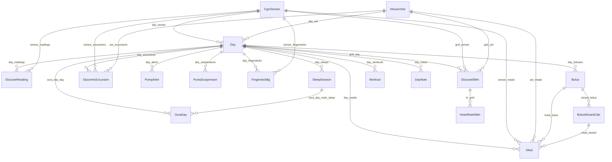

# The ontology layer

The ontology is the semantic layer between the data and everything built on it. Apps, analytics and agents
ask for **objects** ("this Meal", "last night's SleepSession") and follow **links** ("the Bolus for this Meal"),
instead of joining tables. It follows Palantir Foundry's model: object types, properties, link types and
action types, organised into groups.

Everything is declared in one file, [`ontology/ontology.yaml`](../ontology/ontology.yaml). The rest is generated
from it: the validation, the DuckDB views, the client SDK, the Ontology Manager UI and the agent tools.

## 1. Why an ontology

| Without it | With it |
|---|---|
| 17 Parquet files whose meaning lives in people's heads | Named, described object types with typed properties |
| Every analysis re-derives "which bolus belongs to which meal?" | `meal_bolus` is declared once and validated on every build |
| Schema drift breaks things silently | The build **fails** if a column is missing, extra or mistyped, or a key is duplicated or dangling |
| Agents get raw SQL access to undocumented tables | Agents get typed tools (`query_objects`, `search_around`, actions) generated from the same contract |
| Writes go anywhere | Writes go only through **actions** with validated parameters |

## 2. Concepts

### Object types

An object type is a kind of thing in the world, backed by one clean-layer dataset (one row = one object):

```yaml
Meal:
  description: >
    A carb entry (wizard with carbs > 0) and its glucose response over the next 4 h. ...
  backing_dataset: clean/meal          # data/clean/meal.parquet
  primary_key: meal_id                 # unique, non-null, stable across rebuilds
  title: ts_local                      # what the UI shows as the object's name
  display: {group: insulin_meals, icon: utensils, color: "#d946ef"}
  sources: [carelink]                  # upstream systems
  properties:
    carbs_g: {type: double}
    rise_to_peak_mgdl: {type: double}
    trend_at_meal_mgdl_per_min: {type: double, description: "> 0 = already rising at bolus (late pre-bolus)"}
    ...
```

- **Types:** `string`, `integer`, `double`, `boolean`, `date`, `timestamp`.
- **Datasets** (`Glucose5Min`, `HeartRate5Min`) are dense time series on a 5-minute grid: queryable and linkable,
  but not "objects" you open one by one.
- **`optional: true`** types come from sources that may not be connected (Oura) or are created by users
  (write-back). An empty table is valid for them.

### The object types

| Group | Type | One object is… | Primary key |
|---|---|---|---|
| Calendar | **Day** | one local calendar day: glucose metrics (TIR, mean, CV, GMI), insulin (bolus, SmartGuard, TDD), carbs, lows/highs, alerts, suspensions, travel flag, valid-day flag | `date_local` |
| Glucose | **GlucoseReading** | one CGM reading (5-min) | `reading_id` |
| Glucose | **Glucose5Min** | one 5-min bin of the continuous glucose grid (gaps explicit via `has_data`) | `bin_start_utc` |
| Glucose | **GlycemicExcursion** | one low (< 70, level 2 < 54) or high (> 250) episode with its context | `excursion_id` |
| Glucose | **FingerstickBg** | one meter reading, paired with the nearest CGM value | `bg_id` |
| Insulin & meals | **Meal** | one carb entry and the 4-h glucose response (rise, peak, time to peak, pre-bolus trend) | `meal_id` |
| Insulin & meals | **Bolus** | one user-initiated bolus (normal / square / dual) | `bolus_id` |
| Insulin & meals | **BolusWizardCalc** | one Bolus Wizard calculation (carbs, ratio, BG, active insulin, estimate) | `wizard_id` |
| Devices & pump | **CgmSensor** | one sensor's wear period, with accuracy vs. fingersticks | `sensor_id` |
| Devices & pump | **InfusionSet** | one reservoir fill (≈ a set change) and its wear time | `set_id` |
| Devices & pump | **PumpAlert** | one alert or alarm | `alert_id` |
| Devices & pump | **PumpSuspension** | one period of suspended insulin delivery (SmartGuard suspend-before-low, user suspend…) | `suspension_id` |
| Devices & pump | **ClockChange** | one manual change of the pump clock (DST, travel) | `clock_change_id` |
| Sleep & recovery | **OuraDay** | one Oura day: sleep / readiness / activity / stress scores, temperature, HRV, and the main night with its overnight glucose | `date_local` |
| Sleep & recovery | **SleepSession** | one sleep (main night or nap) with glucose and insulin while asleep | `sleep_id` |
| Sleep & recovery | **Workout** | one Oura workout with glucose before, during and 12 h after | `workout_id` |
| Sleep & recovery | **HeartRate5Min** | one 5-min heart-rate bin aligned with the glucose grid | `bin_start_utc` |
| Lifestyle | **Experiment** | a lifestyle experiment the user started (write-back) | `experiment_id` |
| Lifestyle | **DayNote** | a journal note on a day (write-back) | `note_id` |

Every property, its type and description: [`data/reports/ontology_catalog.md`](../data/reports/ontology_catalog.md),
or the **Properties** tab in the Ontology Manager, which also shows live data profiles.

### Link types

A link is declared by a foreign-key property, many → one:

```yaml
link_types:
  meal_bolus:   {from: Meal.bolus_id, to: Bolus}          # each Meal → its Bolus; each Bolus → its Meals
  day_sleeps:   {from: SleepSession.date_local, to: Day, required: false}
```



- **Validation:** every non-null foreign key must resolve to an object on the other side, or the build fails.
- **`required: false`** marks *cross-source* links whose target may not exist yet: Oura nights after the latest
  pump export link to Days that don't exist yet. Those are counted, not fatal. Same-source links are always strict.
- **Search-around** follows a link in either direction: from a set of Meals to their Boluses, or from a
  CgmSensor to every Meal eaten while it was worn.

### Action types

Actions are the **only** way the application layer writes to the ontology (Foundry semantics):

```yaml
action_types:
  create_experiment:
    kind: create                    # create | modify
    object_type: Experiment
    parameters:
      title: {type: string, required: true}
      metric: {type: string, required: true, enum: [tir, overnight_tir, meal_rise, lunch_rise, ...]}
      better: {type: string, required: true, enum: [higher, lower]}
      start_date: {type: date, required: true}
      end_date: {type: date, required: true}
```

`t1d_ontology.actions.apply()` checks parameters against the spec (types, required fields, enums, date order),
then rewrites the backing Parquet atomically under `data/writeback/`. The pipeline never rebuilds that folder.
The Ontology Manager generates a form for each action, and the agent layer exposes each one as a *write tool*
that runs only with explicit confirmation. See [ADR 0006](decisions/0006-writeback-actions.md).

| Action | Effect |
|---|---|
| `create_experiment` | Start a tracked experiment (e.g. "pre-bolus lunch 20 min"), evaluated against the 28 days before it |
| `update_experiment` | Mark completed / abandoned, add notes |
| `add_day_note` | Context the devices can't see: illness, stress, alcohol, travel |

### Groups and display

`groups:` and each type's `display: {group, icon, color}` and `sources:` drive how the Ontology Manager
organises and draws the ontology. They don't affect the data.

## 3. How the ontology is enforced

```
clean layer (Parquet) ──▶ validate against ontology.yaml ──▶ publish DuckDB views ──▶ catalog + quality report
                              │
                              └─ per type: dataset exists · every declared property present with the declared
                                 type · no undeclared columns · primary key non-null and unique
                                 per link: every foreign key resolves (unless required: false)
```

Run it here with `make validate`. In the private pipeline repo it runs on every build (`t1d run`), next to
28 data-quality checks (clock consistency, CGM ranges, dedup, Oura time-zone agreement and more).

## 4. Using the ontology

| Interface | Use it for | Example |
|---|---|---|
| **Python SDK** (`t1d_ontology.client`) | analysis, models | `ont.objects("Meal").where("carbs_g >= 60").search_around("meal_bolus").to_polars()` |
| **SQL** (DuckDB) | anything relational; views are named after types | `SELECT * FROM "Day" WHERE is_valid_cgm_day` |
| **Portable DuckDB file** | notebooks, BI tools, other languages | `duckdb data/ontology.duckdb` |
| **Ontology Manager API** | apps | `GET /api/objects/Meal?filter=meal_slot:eq:lunch`, `GET /api/objects/Day/2026-08-14` |
| **Agent tools** | LLM agents | `POST /api/agent/call {"tool": "aggregate", "args": {...}}` |

## 5. Changing the ontology

1. Compute the new column / table in the pipeline's clean layer (private repo).
2. Declare it in `ontology.yaml`: type, description, links, `display`, `sources`.
3. Rebuild. Validation fails until the data and the declaration agree.
4. Re-export here. The UI, the agent tools and the catalog pick it up with no code changes.

Write-back-only ideas (a new action, a new user-authored object type) need only YAML: declare a type with
`backing_dataset: writeback/<name>` and `optional: true`, plus an action type for it.

## 6. Known limits of the data (read before modelling)

- CareLink's CSV under-counts SmartGuard auto-corrections (~5–7 U/day vs. the CareLink PDF).
- `InfusionSet` is a reservoir fill, not necessarily a tubing/site change.
- Meals are Bolus Wizard entries only.
- Pump replaced ~2026-09-26; Sep 25 is incomplete (gap between exports).
- One person, ~8 months: treat every pattern as a hypothesis, report n, and test changes as experiments.
